<div align="center">


# ColabHive

**聚合你的多账号 Google Colab 云端显卡（`96GB Blackwell G4` / `H100` / `A100` / `L4` / 免费 `T4`），让本地无缝跑科研实验、AI 编程助手（MCP）、0ms 视频生图、ComfyUI Desktop 与无审查大模型 `/v1`。**

<p>
  <a href="https://hexwander.github.io/colabhive/"><b>🎮 在线沙盒体验（免安装）</b></a>
  &nbsp;·&nbsp;
  <a href="https://github.com/hexwander/colabhive/releases/latest"><b>🖥 下载桌面版 (Win / macOS)</b></a>
  &nbsp;·&nbsp;
  <a href="#30-秒极速安装"><b>⚡ 快速安装</b></a>
  &nbsp;·&nbsp;
  <a href="./docs/PLUGIN_PLATFORM_V2.md"><b>🧩 插件平台 v2</b></a>
  &nbsp;·&nbsp;
  <a href="./README.md"><b>English</b></a>
</p>

<p>
  <a href="https://github.com/hexwander/colabhive/releases/latest"></a>
  <a href="./LICENSE"></a>
  <a href="./go.mod"></a>
  <a href="#原生桌面与系统托盘"></a>
  <a href="#一键接入-8-大-ai-编程助手-mcp"></a>
</p>

<br />

<a href="https://hexwander.github.io/colabhive/">
  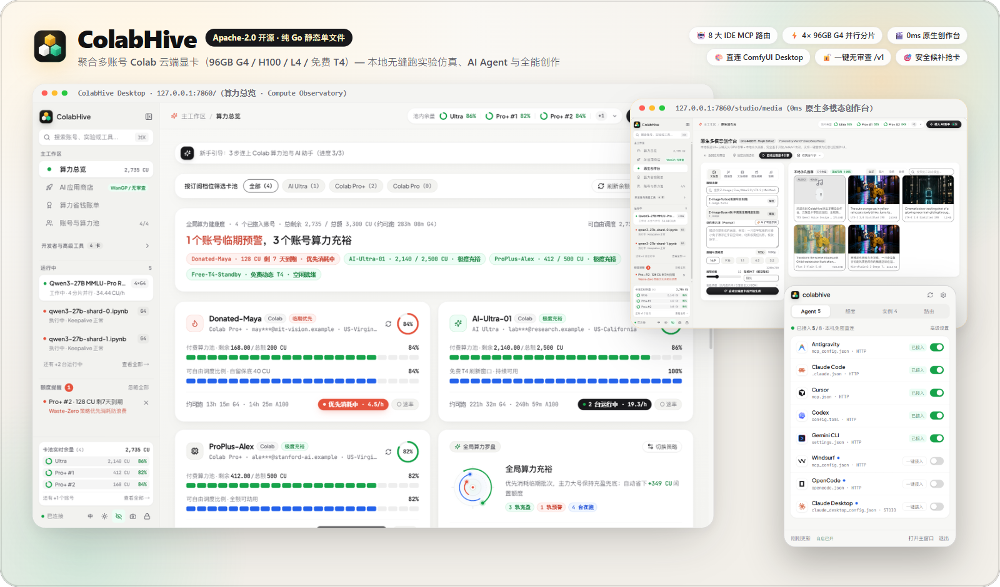
</a>

<sub>
  生态致谢：<a href="https://github.com/deepbeepmeep/Wan2GP"><b>WanGP (DeepBeepMeep)</b></a> · <a href="https://github.com/comfyanonymous/ComfyUI"><b>ComfyUI</b></a> · <a href="https://github.com/unslothai/unsloth"><b>Unsloth</b></a> · <a href="https://jupyter.org/"><b>JupyterLab</b></a> · 灵感源自 <code>sub2api</code> / <code>magpie</code> / <code>cc-switch</code>
</sub>

</div>

---

## ✨ 为什么选择 ColabHive？

**ColabHive** 最初是一款为科研与开发打造的算力聚合工具——将手里各个有计算时长余额的 Google Colab 账号（AI Ultra `2,500 CU`、Pro+ `500 CU`、快过期点数与免费 `T4`）汇入同一个本地算力池，让本地环境与 AI 编程助手无缝对接云端大显卡跑实验与仿真数据，并在此之上构建出覆盖全流程的本地零延迟 AI 工作站：

- **🔬 科研多号聚合 & 4× 并行分片**：`4× G4 (96GB)` 并行跑 1 小时 = 单卡跑 4 小时的 CU 消耗，**提速 4 倍**；内置 8 大 IDE 无头 MCP 与防僵尸进程（`/proc/stat`）自动收割。
- **🎬 0ms 本地多模态创作台 + 永久画廊**：彻底替代 23 MB 远程卡顿 Gradio，支持文生图（7.2s）、图生图、文生视频、图生视频（17.2s）与中文 TTS，关机停表后作品永久留在本地硬盘。
- **🎨 直连官方 ComfyUI Desktop & 一键无审查 `/v1`**：通过自研 `Comm Tunnel v3`（zlib 压缩提速 5–10×）吐出隔离本机地址，零公网穿透、零本机显存占用；内置 Unsloth 零代码微调与 JupyterLab 一键免登。
- **🎯 安全候补抢卡 & 自动防浪费**：遇到 Google Colab `503/412` 缺卡按 `15–45s` 礼貌退避排队防风控（0ms 取消、0 消耗），闲置 30/45/60 分钟自动停机。

---

## 🖼️ 核心功能全景展示

### 1. 8 大 AI 编程助手无头 MCP 路由 & 4× 96GB G4 科研并行工作台

一键无损同步 **Claude Code、Codex、Antigravity、Cursor、Gemini CLI、Windsurf、OpenCode、Claude Desktop**；支持多卡并行分片跑实验与仿真数据、保留 60GB 模型权重热重启、实时显存温度监控与 8 秒僵尸进程自动收割。

<p align="center">
  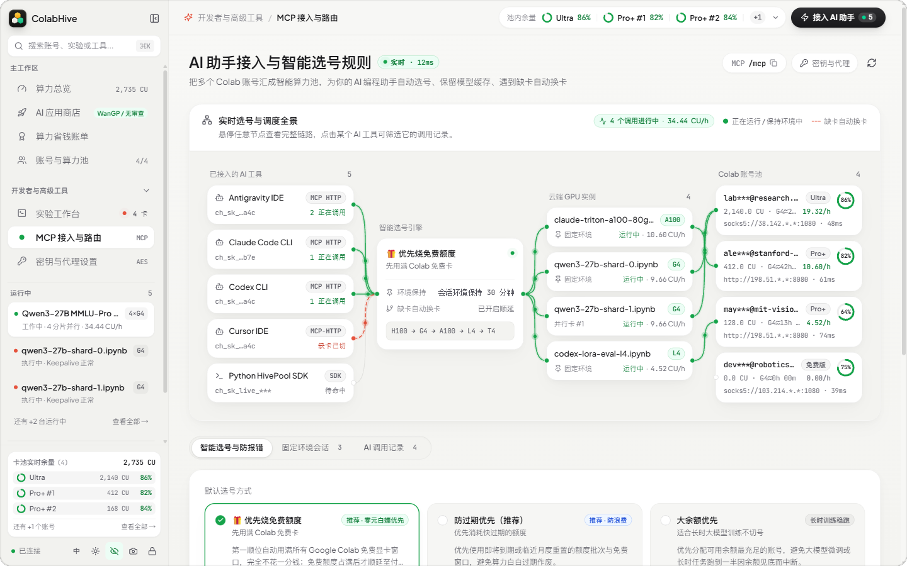
</p>

<p align="center">
  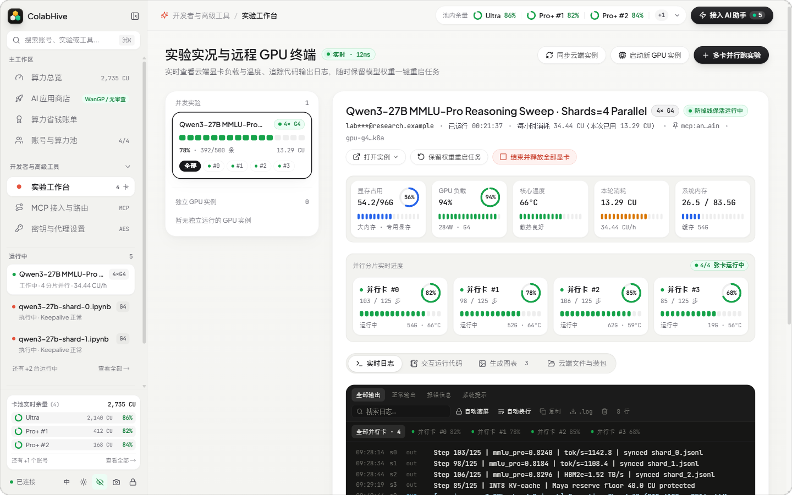
</p>

<br />

### 2. 多账号聚合算力池（`/pool` · 免费卡优先 · 防过期调度）

将手里的 **Google AI Ultra (`2,500 CU`)、Pro+ (`500 CU`)、Pro 与免费 `T4` 账号**统一聚合进一个私有算力池：支持一键本地导入、AES-256-GCM 加密 `.chvault` 迁移、按账号绑定独立 SOCKS5/HTTP 出口代理，并自动优先消耗快到期额度与免费卡窗口。

<p align="center">
  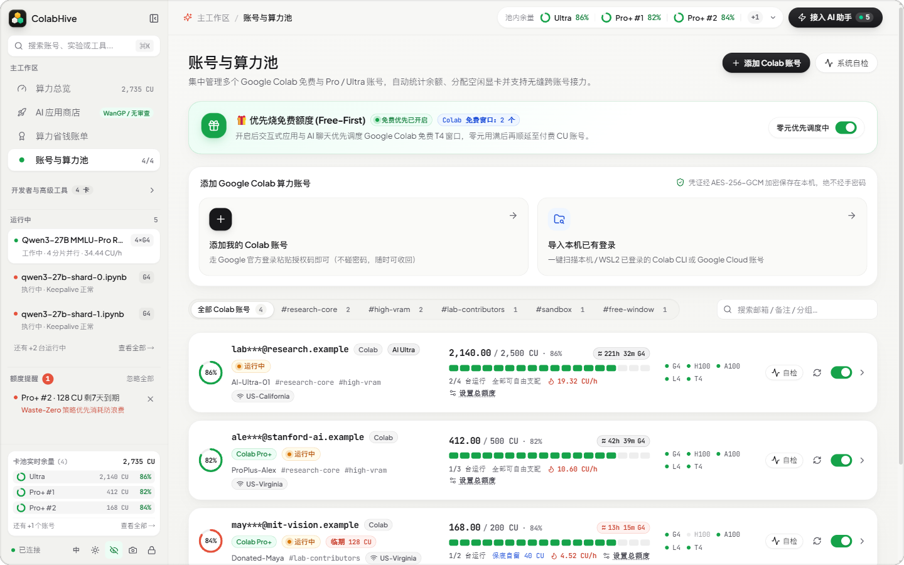
</p>

<br />

### 3. 一键无审查大模型部署（`/apps/llm` · 本机私有 `/v1` 接酒馆与 IDE）

一键部署 2026 社区热门无审查（Heretic / Abliterated）模型——**Qwen3、Gemma 4、DeepSeek、GLM** 或任意 **`hf.co/...` GGUF 直链**。本机 `127.0.0.1:7860` 同时兼容 **OpenAI `/v1`、Anthropic `/v1/messages` 与 Ollama `/api/chat`**，即插即用连接 **SillyTavern（酒馆）、Cherry Studio、Cursor 与 Claude Code**。

<p align="center">
  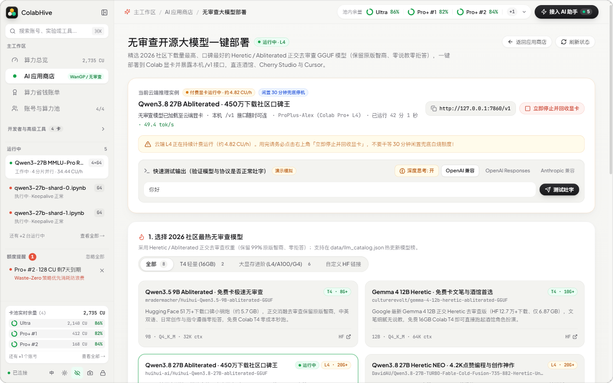
</p>

<br />

### 4. AI 应用商店、ComfyUI 三件套插件 & 安全候补抢卡模式（专治 Colab 503/412 无卡）

一站式配置 **ComfyUI（自动拉齐 Z-Image Turbo / Qwen-Image FP8 / FLUX.2 Dev FP8 完整三件套，独立回环 `127.x.y.z:8188` 直连官方 ComfyUI Desktop & Krita）、Unsloth Studio 零代码微调、JupyterLab 一键免登**与单文件 `colabhive-app.json` 社区插件；内置 **🎯 安全候补抢卡模式**（15–45s 防风控抖动重试、随时 0ms 取消且 0 消耗）与 **🔀 缺卡自动顺延（`H100→G4→A100→L4→T4`）**。

<p align="center">
  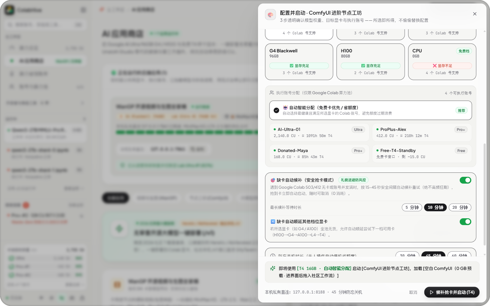
</p>

<br />

### 5. 2× 视网膜算力省钱账单（`/savings` · 100% 零隐私脱敏海报）

真实核算累计云端显卡运行小时、闲置自动关机防浪费次数与等效租卡省钱金额，一键导出 100% 脱敏（零个人邮箱/密钥）的 2× 高清 PNG 晒单海报。

<p align="center">
  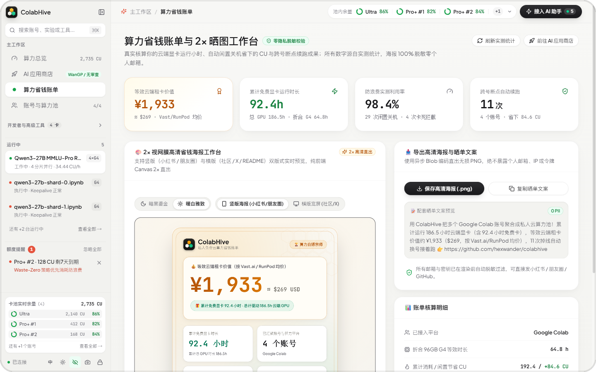
</p>

<br />

### 6. 0ms 原生多模态创作台（Powered by WanGP）+ 本地永久资产库

前端 0ms 秒开，云端只跑轻量无头 GPU 引擎（`media.v1` + 串行排队防冲突）。96GB G4 真机全通 **文生图（7.2s）· 图生图 · 文生视频 · 图生视频（17.2s 热启）· 中文 TTS**，出图立刻释卡，作品永久存本地并支持一键送入图生图/图生视频与**社区 UI 插件热替换**（[`PLUGIN_PLATFORM_V2.md`](./docs/PLUGIN_PLATFORM_V2.md)）。

<p align="center">
  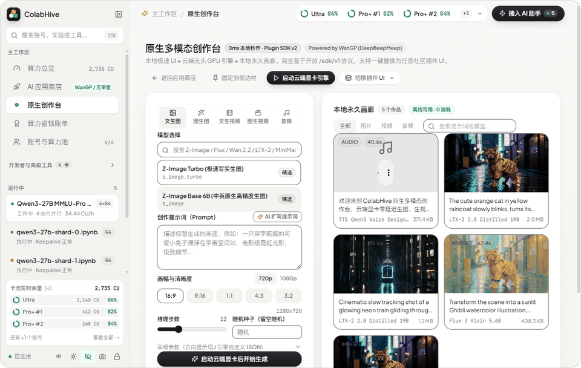
</p>

<details>
<summary><b>📸 展开查看更多界面（算力总览 <code>/</code> · AI 应用商店 · 原生创作台高清静态图）</b></summary>

<br />

**算力总览与显卡小时折算矩阵（`/`）**
<p align="center">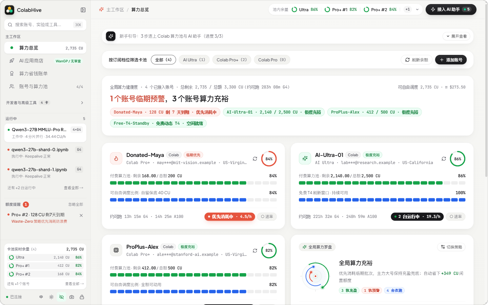</p>

**5 大内置 AI 应用商店（`/apps` · 含 Unsloth 零代码微调 & JupyterLab 一键免登）**
<p align="center">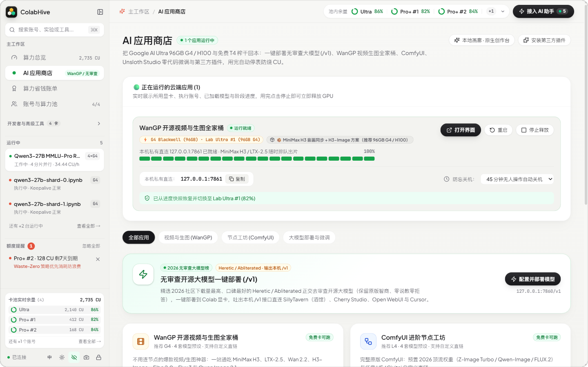</p>

**原生多模态创作台高清静态图（`/studio/media`）**
<p align="center">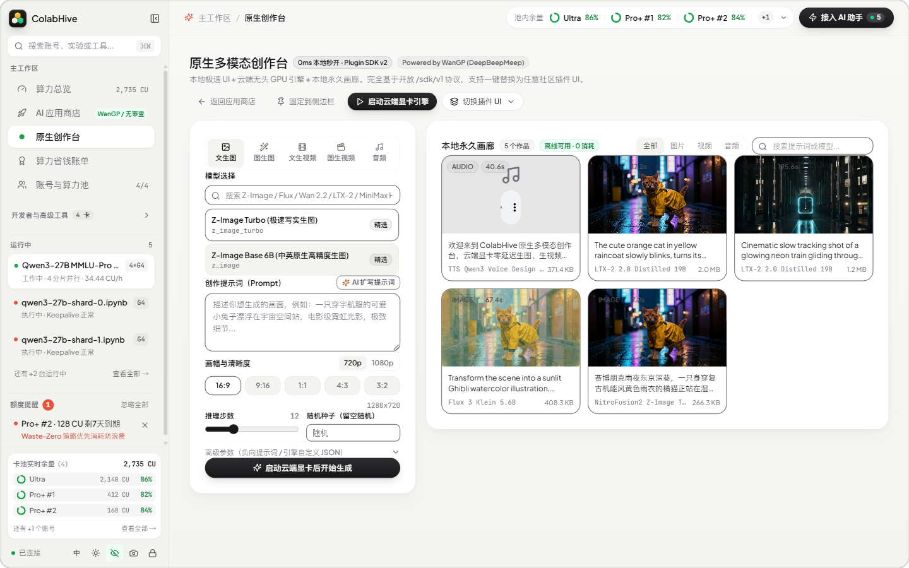</p>

</details>

---

## 🐝 原生桌面与系统托盘

<table>
  <tr>
    <td width="58%" valign="middle">
      <h3>常驻托盘，一键即达，关掉窗口也不掉卡</h3>
      <p>
        致敬 <b>Magpie</b> 与 <b>cc-switch</b> 的精致体验，ColabHive 在 Windows（<code>colabhive-desktop.exe</code>）与 macOS（<code>ColabHive.app</code>）上提供原生无边框窗口与 4 标签系统托盘。关闭主窗口自动退居托盘，云端 GPU 隧道与正在运行的 AI 应用完全不断线。
      </p>
      <ul>
        <li><b><code>Agent · 8 大 IDE</code></b>：一键开关自动注入配置并留存 <code>.bak</code> 备份，本机零密钥即插即用。</li>
        <li><b><code>Quota · 算力池</code></b>：实时汇总全部账号 CU 并折算为 G4 / H100 / A100 / L4 可用小时。</li>
        <li><b><code>VMs · 实时显卡</code></b>：查看显存占用、GPU 负载与核心温度，一键跳回对应 Colab 内核。</li>
        <li><b><code>Router · 实时追踪</code></b>：实时查看 MCP 调用链路，支持开机自启。</li>
      </ul>
      <p>👉 <a href="https://hexwander.github.io/colabhive/"><b>免安装，在浏览器点击体验 4 标签托盘沙盒 →</b></a></p>
    </td>
    <td width="42%" align="center" valign="middle">
      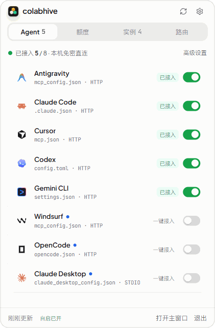
    </td>
  </tr>
</table>

---

## ⚡ 30 秒极速安装

### Windows 原生桌面 + 系统托盘（一行命令）
```powershell
irm https://raw.githubusercontent.com/hexwander/colabhive/main/scripts/install.ps1 | iex
```
> 也可直接从 [**GitHub Releases**](https://github.com/hexwander/colabhive/releases/latest) 下载压缩包，解压双击 `colabhive-desktop.exe` 即用。

### macOS (`ColabHive.app` 菜单栏 + CLI) & Linux
```bash
curl -fsSL https://raw.githubusercontent.com/hexwander/colabhive/main/scripts/install.sh | sh
```

### 团队云端部署（Docker + Caddy 自动 HTTPS）
```bash
cp .env.cloud.example .env.cloud && chmod 600 .env.cloud
docker compose -f docker-compose.cloud.yml --env-file .env.cloud --profile caddy up -d
```

---

## 📊 真机实测性能与架构

| 模块 / 流水线 | 实测显卡 | 实测结果 | 核心亮点 |
| :--- | :---: | :---: | :--- |
| **原生多模态创作台冷启动** | 本地 React (`40 KB` gzip) | **`0 ms`** | 替代 23.3 MB 远程 Gradio，关卡后离线随时看画廊 |
| **文生图 (`Z-Image NitroFusion2`)** | 96GB Blackwell `G4` | **`7.2 秒`** | 串行 GPU 队列 + 实时去噪预览 + 永久本地资产库 |
| **图生视频 (`LTX-2 Distilled 19B`)** | 96GB Blackwell `G4` | **`17.2 秒`** *(显存热启)* | 画廊图片一键送入图生视频，`8k+1` 精准帧对齐 |
| **中文语音合成 (`Qwen3-TTS`)** | 96GB Blackwell `G4` | **`40.6 秒`** *(纯推理 4s)* | 完整 WAV 自动落盘本地，内置音频播放器 |
| **Comm Tunnel v3 (`zlib` + 流控)** | `A100` / `L4` / `T4` | **提速 5.4× – 9.6×** | `/gradio_api/info` `35.8s → 3.7s`，消除队头阻塞 |
| **ComfyUI Desktop + WebSocket** | 免费 `T4` / `L4` | **77s 启动 · `255 ms` API** | 完整三件套自动拉齐 + WS `101` + 隔离 `127.x.y.z:8188` |
| **Unsloth Studio / JupyterLab** | 免费 `T4` | **`2.28s` 首屏 / `41s` 启动** | Unsloth 零代码微调导 GGUF · JupyterLab 一键免输 Token |

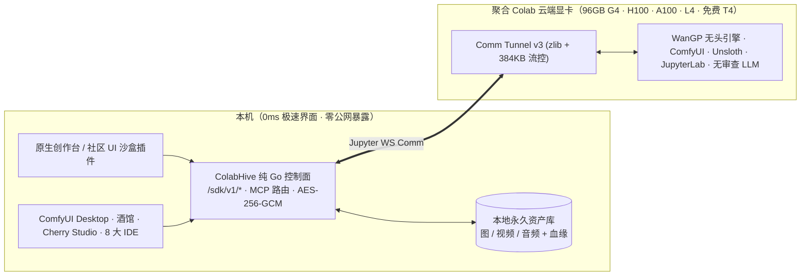

---

## 🔌 一键接入 8 大 AI 编程助手（MCP）& CLI / SDK

<details open>
<summary><b>Antigravity / Cursor / Windsurf / Claude Code / Codex / Gemini CLI</b></summary>

```json
{
  "mcpServers": {
    "colabhive": {
      "url": "http://127.0.0.1:7860/mcp"
    }
  }
}
```
*(Claude Code：`claude mcp add --transport http colabhive http://127.0.0.1:7860/mcp`；本机模式零密钥即插即用，云端模式支持权限隔离的 `ch_sk_live_...` 子密钥。)*
</details>

<details>
<summary><b>命令行 CLI 与零依赖 Python SDK（多卡并行分片跑实验）</b></summary>

```bash
# 查看聚合算力池剩余 CU 与显卡小时数
colabhive usage --gpu-hours

# 跨 4 个账号并行 4× G4 分片跑实验/仿真（总消耗 CU 不变，提速 4 倍！）
colabhive run --gpu G4 --shards 4 --strategy waste-zero --experiment eval_4x eval_shard.py
```

```python
from colabhive import ColabHiveClient

client = ColabHiveClient(base_url="http://127.0.0.1:7860")
with client.session(gpu="G4") as sess:
    sess.upload("./sim_config.yaml", "/content/sim_config.yaml")
    print(sess.exec("import torch; print(torch.cuda.get_device_name(0))").stdout)
```
</details>

---

## 📚 文档、路线图与致谢

- **文档**：[`docs/PLUGIN_PLATFORM_V2.md`](./docs/PLUGIN_PLATFORM_V2.md) · [`docs/PLUGIN_SDK.md`](./docs/PLUGIN_SDK.md) · [`docs/LAUNCH_PLAYBOOK.md`](./docs/LAUNCH_PLAYBOOK.md) · [`CHANGELOG.md`](./CHANGELOG.md) · [`SECURITY.md`](./SECURITY.md)
- **从源码构筑**：Windows `.\scripts\build-release.ps1` ｜ macOS / Linux `./scripts/build-release.sh`
- **路线图**：`v1.2` 规划 Unsloth GGUF 一键直推本地 LLM 部署、日语/韩语/繁体中文多语言包及更多区域算力源适配。
- **特别致谢**：[**WanGP (DeepBeepMeep)**](https://github.com/deepbeepmeep/Wan2GP)（*Powered by WanGP*）、[**ComfyUI**](https://github.com/comfyanonymous/ComfyUI)、[**Unsloth**](https://github.com/unslothai/unsloth)、`google-colab-cli`、`sub2api`、`magpie`、`cc-switch`。

<div align="center">
  <a href="https://star-history.com/#hexwander/colabhive&Date">
    <picture>
      <source media="(prefers-color-scheme: dark)" srcset="https://api.star-history.com/svg?repos=hexwander/colabhive&type=Date&theme=dark" />
      <source media="(prefers-color-scheme: light)" srcset="https://api.star-history.com/svg?repos=hexwander/colabhive&type=Date" />
      
    </picture>
  </a>
</div>

## 开源协议

本项目基于 [Apache License 2.0](./LICENSE) 开源。
